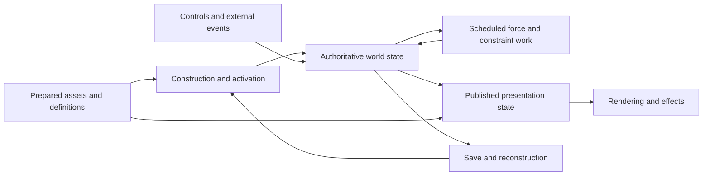

# Replace expensive work, not just its implementation

The current implementation scope is the [whole-runtime redesign](whole-runtime-redesign.md).
The observations below remain evidence for it. Method-level findings no longer
define delivery boundaries or require separate optimization cycles.

Continuum's direction is to replace the systems that create avoidable work. A small optimization is useful when it reveals a boundary or supplies a component of that replacement. A smaller draw count, native implementation or asynchronous API is not the outcome by itself.

## What the current evidence says

The 512-part atmospheric owner now combines six lazy Mach values with complete six-face SetDrag reduction and one complete CubeData publication at the original callsite. Two original-return roots verified 996 complete outputs under the unchanged tolerance; a separate mixed comparison saved 0.2293 ms mean / 0.2426 ms median in complete context cost. Retain this bounded local positive while ordinary deployment remains off. An earlier Mach-only FPS pair was inconclusive; neither that result nor this intrusive local comparison establishes an incremental frame gain. The [shared step context](aero-step-context.md) records both experiments and their distinct controls; [performance evidence](performance-evidence.md) separates component savings, full-workload outcomes, capacity and fidelity failures.

The admitted managed owner proves the larger transaction boundary without moving native forces or changing recursive part order. It copies current face inputs into temporary value rows and computes the complete result before publication. A further resident or native aerodynamic owner must earn capture, conversion, transfer, synchronization and publication costs and preserve animated inputs, topology generations and provider authority. That path stays available; it is not automatically the next largest opportunity.

The [aligned native diagnostic](flight-process-diagnostics.md) points next toward remaining main-thread production: managed fixed is the largest observed bracket and script Update is also material. Recognized main-thread waiting is low while graphics-worker waiting is substantial, but unknown Unity work and GPU-fence interpretation remain unresolved. Use already captured stacks plus bounded callback attribution to choose a coherent state/analysis/scheduling owner for original replay and redesign. Do not infer GPU execution from render-end wall time or repeat rejected timestamp queries.

The actual stock quickload producer also passed the selected 256-part physical reconstruction gates after original mass/center publication moved before the first packed mass-bearing statistics call. The [checkpoint result](checkpoint-reload.md) keeps that construction-order proof separate from general mod/reload deployment. Startup PartLoader/terrain, retained rendering and HMR, physics decomposition and whole-game modern Unity migration remain open fronts.

The first current 256-part quiet-vacuum checkpoint now has 170 awake rigidbodies, 204 joints, 388 colliders and 645 modules. One normal-time observation measured 80.55 FPS and 1.003x simulation over ten simulated seconds; one 4x observation measured 70.44 FPS and 4.017x simulation over forty simulated seconds. Both captured about ten wall seconds with stable topology. Stock warp changed the integration step from 0.02 to 0.08 seconds; these are different workloads, not an equal-fidelity optimization comparison. The experimental main-view shader remains a separate fidelity gate.

The rendering parent occupied 5.03/4.59 ms per rendered frame at normal time/4x, including FinishFrameRendering at 4.32/3.92 ms. The fixed parent occupied 3.51/4.16 ms; native physics averaged 1.66/1.65 ms per step and managed fixed work 3.93/4.13 ms per step. Update occupied 1.57/2.24 ms and PreLateUpdate 1.01/1.09 ms per frame. These overlapping wall brackets do not identify exclusive CPU work or GPU duration. Rendering remains the largest observed phase, with fixed work close at warp. This quiet fixture does not reproduce the broader large-craft/atmospheric slowdown. It selects the supported real-material rendering consumer next; it does not select a wholesale physics rewrite or settle excited, atmospheric or 512-part capacity.

The [resident material runtime](resident-material-runtime.md) now has a shipped-shader oracle and a corrected mapped-family consumer. Five native visual states passed the frozen gate; one compatible full-game pair observed 13.803→13.028 ms mean frames with complete controller cost of 0.615 ms/frame included. This replaces only 156 renderers through five packets per camera and does not qualify the whole vessel. Advance toward a larger resident vessel/scene boundary and explicit visual-state ownership. The completed panel comparison measured 79.40/79.37 FPS, with 0.116 ms/frame nested GUI cost and zero hidden callbacks. It does not select the panel as a throughput bottleneck. Keep the existing named-callback probe available for a workload where managed fixed work becomes the dominant unresolved owner; the prior atmospheric callback ranking cannot substitute for a vacuum ranking.

The frozen 196-part atmospheric flight rose from 15.73 to 43.08 FPS when the reentry cameras received seven geometry packets instead of 530 original sources. The measured FinishFrameRendering interval fell from 29.63 to 8.88 ms per frame. This is strong evidence for repeated rendering/submission as a costly architectural boundary in that workload.

Adding a supported main-view shader and instancing path produced 46.08 FPS in one subsequent observation. It admitted 279 renderers into 37 packets, but FinishFrameRendering barely moved, to 8.79 ms. The shader changed and the observation is not an isolated, repeated comparison. It does not prove that extending the same batching technique will produce a large further gain.

The latest corrected retained candidate spends 5.90 ms per rendered frame in the enclosing fixed phase, 2.37 in script Update, 1.30 in PreLateUpdate and 10.06 in PostLateUpdate, including 8.92 in FinishFrameRendering. These are wall intervals with nested work; they are not exclusive CPU costs or GPU execution timings. Physics and modules remain candidates for other workloads, particularly higher part counts and warp.

Startup already restores 1,639 prepared textures instead of repeating their original processing. A new native profile measured all 627 model reads at 0.84 seconds and 479 successful part parses at 2.86 seconds, including 0.70 seconds for icons. Internal props and spaces together took 0.13 seconds. These synchronous scopes include observer overhead and mixed native work; they do not explain most of the 28.36-second admission-to-menu run. Warm startup already uses saved drag cubes; 426 dispatches are not evidence of 426 GPU drag renders.

The completed texture and identity slice targeted five PNG normals with about 2.02 seconds of texture boundary gaps and six independent hashes of the same game assembly. Its installation intervals also contained patching and JIT; the entire 2.45-second installation span was not attributable to hashing. Planet-scene loading takes another 2.76 seconds, and launch-site setup 4.44 seconds with terrain construction and a stock wait. Deferred terrain currently fails the frozen position-parity check and remains experimental.

## Prepared assets and explicit construction

Build one content-addressed asset store with cheap catalog metadata, immutable model recipes and independently requested construction capabilities. Geometry, materials, collision, icons, runtime part behavior and interior data have different consumers and lifetimes.

Workers prepare and map immutable CPU data with private scratch. One Unity owner constructs and publishes complete engine objects. Stable recipe IDs bind source content, resolved configuration, dependencies, engine publication recipe and producer version. Share mesh payloads where stock semantics permit; keep mutable hierarchies and components separate where callers expect clones.

Prepared texture coverage and shared validated launch identity are implemented. Prepared model recipes are a useful later extension of the same store, retaining original part/module construction order, but the measured 0.84-second model total does not justify making that reader the next large optimization. Eager icons and interior object residency remain smaller targets. Crew assignment also consumes interior/seat information before the player enters IVA; camera entry alone is not a sufficient readiness boundary.

Synchronous consumers receive actual ready objects. Known startup consumers get a complete dependency closure before invocation. Unknown callbacks, direct public fields and shared-prefab mutation retain explicit eager compatibility paths. A future must not masquerade as a Unity object, and the Unity thread must not wait on a worker that needs that same thread to publish its result.

Native workers or a sidecar are useful where they remove repeated parsing, permit independent preparation or preserve useful state across game launches. Start with mapped immutable artifact pages and batched descriptors. Add transient shared buffers only for measured repeated traffic. Do not transmit Unity pointers or issue a request per part per frame.

The model slice must falsify unsupported-format fallback, clone/shared-prefab identity, hierarchy/mesh/material/collider/animation/bone equivalence, changed callback order, and a complete-startup regression after admission and publication are charged.

The completed texture extension now prepares all 1,644 rows, including the five stock-generated normal-map mip chains, with five readability restorations and no unrepresented rows. Reuse reports 1,644 hits and zero fallbacks. An independent audit found all 1,639 previous rows unchanged, checked every distinct new-image payload digest, and verified the added RGBA mip layouts and equal mapped RGB channels. Source-channel decode and GPU sampling fidelity remain separate gates. Shared game identity performs one physical hash and five guarded reuses. The observed prepared launch fell from 28.36 to 26.16 seconds; this combined treatment is one resolving observation, not an isolated speedup for either component.

## Retained vessel rendering

The shared launch contract now resolves the existing startup and flight controls into one typed selection, then freezes actual required binaries, settings, checkpoint and prepared metadata. `resolve` and `run --launch-profile` share that envelope; replay reconstructs its required inputs and rejects drift or hidden overrides. This replaces the runner's positional startup interface while retaining legacy CLI compatibility and detailed provider reports.

The first shared asset-generation lifecycle connects catalog metadata, cooked texture restoration and prepared DLC. Its digest binds selected metadata and the frozen texture producer separately from the current helper and run nonce. Existing manifests embed installation paths, so relocation independence remains open. Provider content checks still establish admission; actual publication coverage establishes readiness. Menu/shutdown receipts bind those outcomes to the exact launch profile, run and process. Recording failure is contained outside provider ownership and marks evidence degraded. This remains scoped prepared-startup coverage, rather than a complete asset store, capability scheduler or crash-recovery supervisor.

Build a vessel rendering service around shared immutable assets, stable instance IDs and contiguous changing pose/thermal/highlight state. Construct its topology once per vessel generation. Read each physical part pose once, update supported animated roots, and publish one snapshot for main view, shadows and effects.

The service must take rendering ownership for admitted sources. The corrected prototype now disables 267 admitted originals throughout the flight, while preserving all 279 sources in 37 main-view packets. It publishes 69 rigid and 198 dynamic source poses, shares bounds with FX consumers, and owns 163 animation culling settings so disabling renderers does not suspend their animations. Twelve main-view sources outside owned FX coverage retain their original camera leases. Components remain for property-block writers; the native transform/bone graph and per-frame material/property polling remain.

Native experiments rejected renderer bookkeeping as the next large throughput win in this fixture:

| Treatment | Mean FPS | Mean frame | p95 / p99 | FinishFrameRendering |
| --- | ---: | ---: | ---: | ---: |
| Clean current batching control | 47.56 | 21.03 ms | 26.50 / 40.60 ms | 8.59 ms/frame |
| First retained provider, reduced coverage | 42.12 | 23.74 ms | 32.73 / 42.90 ms | See retained raw receipt |
| Corrected retained provider, full coverage | 46.31 | 21.59 ms | 27.29 / 41.04 ms | 8.92 ms/frame |
| Same corrected provider, shadows disabled | 52.40 | 19.08 ms | 22.72 / 39.34 ms | 7.73 ms/frame |

The first provider admitted only 69 main sources because animation exclusion accidentally discarded existing batching coverage. The correction preserved coverage, published dynamic transforms and restored all 267 renderer and 163 animation leases with zero provider faults. Its maximum initial recovered corner error was 2.19 micrometres against the frozen 5 mm gate. Correct ownership did not produce a useful speedup; retained mode remains experimental. The clean control and corrected provider differ in helper binary and declared retained treatment; this is a resolving development comparison, not an isolated same-binary speedup claim.

The shadow counterfactual uses the same helper, files, shader and request except the shadow treatment. Effective shadow distance was zero; the engine normalized the requested zero cascades to one. It reduced the rendering bracket by 1.19 ms/frame, while complete frame cost fell 2.51 ms/frame. More rendered frames share the same simulated interval, so fixed work per rendered frame also falls; this is not a physics optimization. Suppressing shadows does not qualify an equivalent playable improvement and still misses the FPS and tail goals. It does not account for most remaining rendering cost.

A capture-aligned native sample counted 2,967 graphics-worker stack occurrences: 1,147 in driver submission, 1,237 in waits/events and 583 in unresolved Unity work. These are exclusive call-tree sample counts, not CPU milliseconds or game-wide percentages. The asynchronous GPU observer exercised all five camera roles, but the actual OpenGL driver reported zero timestamp counter bits and rejected initialization. Query cleanup and archived publication accounting completed; no GPU execution evidence qualified. Do not repeat the rejected timer experiment on the unchanged backend or infer GPU utilization from the rendering bracket.

The next substantial boundary is the rendering pipeline: repeated geometry/effect passes, camera submission and backend cost. Use shared vessel depth/normal/coverage and a bounded flame consumer rather than further per-renderer tuning. Preserve the separate flow-axis occlusion projection; it cannot simply reuse screen depth. OpenGL's two flight cameras also carry near/far depth and fog responsibilities, so a merger requires explicit depth/compositing coverage. A matching-2019 Metal reconstruction is a competing backend route; choose between them with a bounded actual rendering proof, not promised FPS.

Geometry, moving poses, texture/shader inputs, lighting, shadows and effect behavior require concrete fidelity checks. A fewer-pass shader with different appearance cannot establish an equivalent speedup. Full-frame measurements include state capture, conversion, synchronization and publication.

Particles and instancing are candidate consumers of this shared rendering state. A hybrid reentry renderer can construct vessel coverage once, use a bounded surface/volume contribution for the sheath, and use instanced ribbons or quads for streaks and wisps. The same machinery could support condensation trails, exhaust and sparks after their behavior is defined. Pool emitters, share materials, retain per-instance state, and bound projected coverage and LOD; replacing shells with excessive transparent overdraw can merely move the cost.

The current OpenGL 4.1 player needs an explicit backend path. Unity 2019's built-in mesh-particle GPU instancing requires shader target 4.5, whose OpenGL support begins at 4.3. It cannot be assumed available here. Custom ordinary instanced quads with vertex-shader motion can use the established lower-feature instancing route; compute-driven particle simulation belongs to a qualified backend such as a future Metal player. Particle simulation and particle draw instancing are separate capabilities. See [Unity particle instancing](https://docs.unity3d.com/2019.4/Documentation/Manual/PartSysInstancing.html) and [shader feature requirements](https://docs.unity3d.com/2019.4/Documentation/Manual/SL-ShaderCompileTargets.html).

## Current flight camera and scene boundary

One current 196-part atmospheric field-renderer flight observed 22 cameras and 3,373 renderers. Positive ancestry identified 2,114 PQS-owned rows (1,618 active and enabled), 781 part-owned rows (772 active and enabled), and 478 unclassified rows. Kerbin and KerbinOcean account for the PQS rows; ancestry includes facilities and does not distinguish visible terrain quads from other descendants. These are inventory counts, not draw counts or a ranking of GPU cost.

The two local flight cameras share a layer mask but use near/far ranges of 0.21–400 m and 397–750,000 m. The 3 m overlap does not establish duplicated world drawing. The near camera also owns depth production, highlighting and the admitted field renderer's scene-depth command; the flow projection retains a separate 2,048-square target. Removing a camera would remove these responsibilities or distant world coverage.

The world-draw counterfactual is implemented and ran as one matched same-helper pair with the camera-chain observer disabled. Both arms preserve PQS computation, collision, cameras, materials, vessel and field providers; both use the same bounded ownership observer. Suppression changes only admitted `forceRenderingOff` flags. The first two admission attempts rejected incomplete ownership and are excluded from comparison. Native evidence showed nearby quads move into a separate `PQStorage` under the celestial body for precision. The repaired rule combines positive PQS ancestry with the exact native `PQ.meshRenderer`/`PQ.sphereRoot` link, retains whole-chain Part/Vessel exclusion, and inventories local storage. Six pinned creation/return hooks cover supported leases; an endpoint audit rejects missed or changed ownership.

| Same 196-part atmospheric field-renderer case | Mean FPS | Simulation rate | Mean frame | p95 / p99 | FinishFrameRendering |
| --- | ---: | ---: | ---: | ---: | ---: |
| Stock PQS drawing with owner observer | 51.96 | 0.9987× | 19.246 ms | 24.738 / 38.383 ms | 7.949 ms/frame |
| PQS drawing suppressed with same observer | 53.08 | 1.0011× | 18.838 ms | 24.044 / 33.149 ms | 7.658 ms/frame |

Both arms admitted 2,389 lease generations, including 60 dynamic admissions, and restored every lease with zero faults and complete endpoint coverage. Native quad links account for 940 leases; ancestry accounts for 1,449. Initial inventory cost was 81.9/86.0 ms outside capture. The frame context/flag check averaged 0.222/0.230 ms over the diagnostic lifecycle; this partial counter excludes dynamic hooks, inventory, audit and cleanup. Complete frames include in-window controller work. Frozen profiles and inputs match except the declared suppression mode, and effective controls match. Field readbacks, provider restoration and native screenshots passed.

The observed 0.408 ms (2.12%) mean-frame reduction does not select PQS drawing as the next substantial replacement in this view. Stop after the resolving pair. This is a deliberately incomplete visual treatment with one observation per arm, no confidence interval or playable gain. Scaled-space planet rendering remains visible, terrain computation continues, and culling/bookkeeping may remain. Unknown transient mod ownership, other views and complete PQS retirement are unresolved. Rendering brackets are wall costs, not GPU duration; capture CPU/RSS was not collected.

The admitted mapped material family now preserves original tangents, published texture content, sampler/mip/color semantics, separate stock/prepared bindings, visual state and selected shader globals. Its native stock oracle proves the selected surface states; the full-game observation charges capture and publication. Broader reflection, underwater and shadow coverage remains open. Extend the resident contract toward a meaningful vessel/scene consumer rather than repeating the small-family pair. Neither gray-fixture timings nor callback envelopes can rank missing GPU owners by subtraction. Resident terrain/ocean LOD, depth and shadow ownership stays available when a different view or world-cost observation justifies it.

## Mods, atmosphere and persistent effects

KSP, Unity and installed mods all belong in the private research scope. [Mod-system research](mod-system-research.md) maps FAR/MFI, MechJeb, KER, Scatterer, PlanetShine and plume systems to their actual owners and concrete admission obligations. Existing asynchronous preparation, retained effects and floating-origin handling are donors, not work to rediscover. Browsed source heads are distinct from installed providers; no mod integration or speedup is implied by the audit.

Keep aerodynamic fidelity, atmospheric observations, optical composition, engine effects and weather as independently selectable responsibilities. Stock-compatible and FAR behavior are different contracts, so begin with separate admitted profiles. A live toggle must own every force/thermal/control channel and invalidate stale geometry, rather than only replace a registration delegate. MechJeb/KER may share topology-bound observations or analysis while preserving distinct control and readout semantics.

Persistent trails retain world history independently of an emitter's current state. An origin shift changes the rendering coordinates, not trail history; throttle-off stops new emission but need not erase existing material. Wind, diffusion, lifetime, time warp and reconstruction policies are explicit. Artistic dissipation can be useful before humidity/cloud microphysics exists, provided its fidelity is declared. Weather supplying wind, clouds and precipitation is a longer-term capability; optical haze alone cannot stand in for that state. A small offline trail fixture and a meaningful powered-flight situation are concrete future consumers, alongside the next measured main-thread replacement.

## Continuous whole-runtime redesign

Continuously redesign while replacing coherent owners. Maintain a broad map of actual execution, authoritative state, readers/writers, readiness dependencies and cost. Deepen reconstruction where it can resolve an implementation choice. The private searchable assembly/asset index is a shared reference; full source reconstruction is not a prerequisite for every useful change. Conversely, replacing isolated functions without understanding their dependency chain can preserve the architectural cause.

The proposed target separates these responsibilities:

This is a target responsibility map, not a claim that Continuum owns live motion today. KSP and its installed providers retain domains until a qualified replacement owns all required inputs, outputs and lifecycle. Compatibility adapters sit at those boundaries. A modern Unity port can host the preserved game logic sooner; a native alternative can progressively own more of the same contracts. Keep those routes comparable rather than requiring one engine choice to precede every experiment.

Do not use authored Part boundaries as the universal compute, mechanical, rendering, storage and scheduling decomposition. Preserve part identity for gameplay and compatibility while choosing compact force rows, coupled constraint groups, render packets and durable save records for their actual jobs. KSP already shares some physicsless bodies; further reduction must respect physical coupling and independently verified behavior. Dirty generations and state validity can remove unnecessary recomputation; asynchronous jobs help only after their true dependencies and publication boundary are understood.

Select the next change by three forms of evidence: the current critical path, unnecessary repeated work, and defects in cross-system ownership/readiness. The mass/center fix is a concrete example of the third: physical placement consumed incomplete construction state. Completing the original owner before packed statistics fixed the selected checkpoint without repairing pose or widening tolerances. Its saved-epoch error improved from about 10.7 cm to 1.7 µm; preventing every destructive loading failure remains an open behavior question.

The immediate coherent performance slice combines six-value reuse with retained complete SetDrag arithmetic in a root-level aerodynamic transaction. The integration goal is one current input capture, fused ordered computation and one publication pass. In parallel, maintain the prepared-startup/PartLoader and renderer/backend routes, and extend reconstruction situations to staging, docking and loading failures. Revisit the whole map when an owner changes, a retained component becomes relevant, or a deeper dependency appears. A fundamental bottleneck may unlock large gains; its existence and magnitude remain hypotheses until measured.

The strongest competing strategy is complete private reconstruction first, then global optimization. It is appropriate when unavailable engine/project state blocks a meaningful boundary or when a whole-game modern Unity migration becomes the selected outcome. It does not win as the default sequence now: current experiments already expose and repair architectural causes, while complete source/project recovery has separate unresolved obligations. Independent subsystem replacements followed by a late redesign also risk incompatible state models and duplicated bridges. A shared responsibility map plus continuous redesign gives each useful checkpoint a path into a larger runtime.

Open questions are the actual CPU/wait/GPU critical path of representative heavy flight, the net contribution of retained candidates after integration, equivalent large-craft constraint decomposition, mod ownership coverage and complete modern-game reconstruction. The authorized boundary remains local private research and reviewable Continuum source. Publication, distribution, main promotion and Gimbal implementation changes are separate decisions.

## Computation ownership experiments

Do not translate every PartModule into Rust independently. Where measurement identifies repeated graph traversal or redundant derived state, compile the relevant flight dependency graph, store persistent contiguous state and schedule work only when its inputs change. Publish compatibility views for existing modules and consume state in batches.

Keep forces, resources, physics, rendering and saving under explicit owners. Replacing one owner requires the supported equations and events, topology invalidation, cancellation, save/reload and independent numerical checks. Native physics is not the dominant measured cost in the current atmospheric case; that does not settle large-craft or warp behavior.

Modern Unity/ARM64/Metal remains a separate whole-runtime path. The matching Unity 2019 editor and actual shader build/load loop now work locally. That removes a real tooling obstacle to new rendering consumers; it does not qualify a migrated game.

The [local-camera ownership diagnostic](rendering-ownership.md) removed one complete native pass in the 256-part quiet-vacuum view. A same-helper hidden/stock versus hidden/merged comparison observed 79.37→83.56 FPS, 12.599→11.967 ms mean frames, full simulation and exact restoration. The stock D3D11 design is the concrete donor; applying it to OpenGL changes depth precision and sorting. This single pair does not qualify ordinary-play visual equivalence. The remaining enclosing rendering cost still exceeds fixed work in this view, so move toward the engine/backend boundary rather than repeat the camera pair.

Readonly BuildSettings inspection resolves OpenGLCore-only admission in the game and Metal/OpenGLCore in the matching-version workbench, with raw IDs mapped using the pinned managed runtime. The prior forced-Metal launch failed before initialization; this is not proof the binary lacks Metal. The next operation changes only the graphics API array in a disposable copy, preserves every other field/object and serialized identity, and proves actual Metal initialization plus visible pixels from a known same-version shader. Then reconstruct stock shader/material closure and prove menu plus part rendering before terrain, shadows and effects. The shipped camera merger specifically tests D3D11, so admitting Metal does not automatically transfer that ownership. Modern Unity and native ARM64 remain later routes, with original managed behavior retained for this nearer experiment.

## How to decide when to move on

Choose a system replacement with a stated source of avoided work and a usable first consumer. Continue within it while new evidence identifies substantial remaining avoidable work. Move to another system when the dominant cost moves, an engine boundary blocks the current route, or the next step has poor expected benefit.

Use measured costs and workload behavior to select the route. Keep FPS and startup time as outcomes rather than inventing a promised speedup. Two agreeing observations can settle a direction; additional runs need a specific resolving question. A failed behavior check remains a failure even when performance improves.
