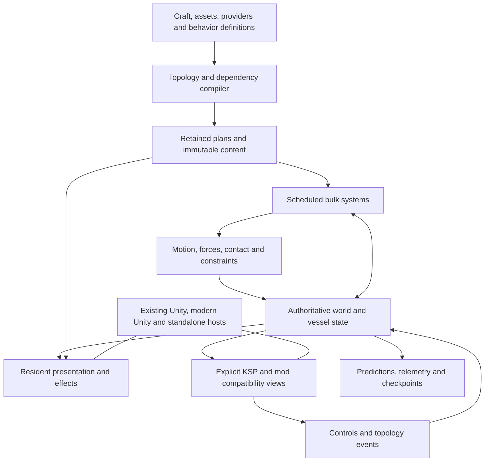

# Whole-runtime reconstruction and coordinated redesign

Continuum aims to provide a better implementation of the KSP experience. Whole
runtime replacement is in scope. The execution unit is a coordinated outcome
across ownership, representation, scheduling and consumers; a method-level
finding is evidence inside that outcome, not a reason to create another small
delivery cycle.

## Evidence base and coverage

The whole-installation tools now recover searchable managed source and map
assembly identities, types, fields, methods, declared call targets, data
accesses, engine bindings and unresolved runtime targets. They cover game,
installed plugins, engine/framework libraries and launcher separately. The
launcher is inventoried but its library closure must not contaminate the game's
resolution context. Native binaries have architecture, load-dependency and
section metadata; their implementation is not recovered by managed tooling.

The first actual installation map contains 187 managed payloads: 89 game-host
libraries, nine installed plugins and 89 launcher libraries. Source recovery
produced or reused 24,210 C# files. The IL map contains 305,009 methods,
1,155,554 declared call edges and 857,132 field-access edges, plus 15 native
binaries. These totals include framework and launcher code; they are not counts
of executing game objects. Game assemblies contain 52,511 methods and installed
plugins another 24,039. The context-correct map retains 32,835 unresolved call
targets and 140,112 dynamic dispatch obligations explicitly.

Successful decompilation is searchable input, not an unchanged C# rebuild.
Recovered game source contains obfuscation-shaped constant control flow and
method-token constructs that need reconstruction work. IL instruction,
allocation-site and backward-branch counts describe static structure; they do
not identify executed work or prove a performance bottleneck. Existing managed
rewrite/source-canary proofs remain valid only for their declared assemblies.

The profiling evidence already spans startup, stock/rigid flight, atmospheric
effects, native physics, control/modules, observation, rendering, workbench and
state transitions. It does not form one additive cost breakdown. Major findings
are repeated rendering submission in atmospheric workloads, substantial managed
fixed/update production, and expensive repeated acquisition/publication and
observation relative to small numeric kernels. GPU duration and a current
whole-game exclusive cost map remain unresolved. No single historical workload
selects the largest bottleneck for every scene.

## Target architecture

Compile authored craft, assets and provider definitions into retained execution
plans. Keep authoritative state independent of Unity objects, save schemas and
diagnostic snapshots. Systems consume current state through specialized views;
physics, presentation, prediction, compatibility and observation are consumers
with explicit update and ownership requirements.

The diagram describes the target, not a claim that every owner exists today.

| Responsibility | Coordinated change |
|---|---|
| Definitions and assets | Content-addressed cooked data, dependency closures and capability-specific construction; retain decoded/compiled data across runs where useful. |
| World, vessel and part state | Stable identities, double-precision local/world frames, explicit revisions and domain writers. Authored parts retain identity without requiring one physical body per part. |
| Topology | Compile structure, rigid regions, resource routes, thermal/aero relationships, provider bindings and render instances; rebuild affected plans on stage/dock/break/mechanism events. |
| Part systems | Coarse scheduled passes over retained numeric columns, dependency-aware reductions and explicit compatibility calls; avoid a job, message or native crossing per part. |
| Forces and motion | Accumulate declared forces/moments into physical regions; rigid assembled craft is primary, articulated mechanisms/contact are explicit, compliant wobble is optional. |
| Queries and compatibility | Current-epoch views at declared consumer boundaries; preserve required side effects/order, and identify fields/providers that still have external writers. |
| Presentation | Retained geometry/material/instance state, shared craft pose and scoped changes; visual interpolation and LOD are separate from authoritative integration. |
| Observation and recovery | Cheap bounded counters by default; explicit detailed proof/capture modes, immutable checkpoints and generation-safe HMR. JSON is a cold control/export format. |

This changes the work itself: derive shared context once, compile stable
relationships once, execute dense/sparse numeric work directly, and publish only
what a current consumer requires. It does not reproduce every old callback in
Rust or route the whole world through a universal snapshot/ECS row.

Use specialized arrays and retained graphs where dependencies are known. ECS is
an option for genuinely variable membership/query workloads. Backend selection
belongs outside inner loops. CPU, SIMD, native workers and GPU residency are
placements for those plans; compare complete acquisition-to-consumption cost.
Existing synthetic GPU or arithmetic timings do not establish a game routing
threshold. A small rigid craft need not run on the GPU to be cheap.

## Reconstruction and hosts

Use the matching Unity host as the first integration environment for the
reconstructed managed runtime. Recover and rationalize managed code/IL broadly,
then implement the authoritative retained model and adapters as a coordinated
package. The full old assembly's source roundtrip is useful research, but it
must not block original replacement implementations that already have a valid
integration boundary. Stock objects become explicit compatibility or
presentation facades rather than the preferred simulation store.

Modern Unity and the standalone workbench/runtime are alternate hosts for this
model. Modern Unity additionally requires real scene/prefab/script references,
shader/material reconstruction, startup and native-dependency closure. A
standalone host requires its own renderer, physics/query integration and player
interaction. Engine migration alone does not remove duplicated managed state or
per-part work. Neither route is excluded; the shared runtime design keeps them
from becoming unrelated implementations.

An in-process Rust library in the existing game must match the host's process
architecture. An ARM64 sidecar can retain prepared data or own native execution
while the game remains translated. That split earns its benefit only with bulk
typed transfers, retained state and a narrow publication boundary. Use shared
immutable mapped pages and leased numeric banks where the traffic warrants
them. Messages carry commands/epochs/descriptors, not per-part JSON state. Never
lend engine pointers across processes, overwrite a reader's bank, or hide
required completion behind unbounded queues.

## One large implementation package

Develop these responsibilities together on the existing branch lineage:

1. Build the retained world/vessel state and compiled topology/provider plans,
   with writer-produced revisions, event transactions and hot-reload state
   admission. Move broad systems onto those plans rather than assembling
   isolated caches around every original callback.
2. Integrate aggregate rigid motion, bulk control/resource/aero/thermal work,
   existing correct kernels and current-epoch query facades. Handle topology,
   frame/time changes, force ownership and compatibility together. Unsupported
   providers must retain an explicit stock-owned domain or reject admission;
   they must not silently create two authoritative writers.
3. Feed resident rendering, effects and debug views from the same state/plans.
   Share immutable assets and generation-qualified instance data. Remove
   duplicated capture/publication only where actual reader/writer dependencies
   are closed.
4. Connect prepared startup/construction, checkpoint/reload, editor/staging and
   docking transitions to those owners. Preserve useful prepared assets and
   workbench HMR instead of making every iteration reboot the game.
5. Measure the complete integrated implementation across representative
   gameplay. Keep subsystem correctness and local cost evidence; determine
   capacity, latency and user-visible gains at the whole-consumer boundary.

These are implementation responsibilities inside one delivery. They are not
five mandatory branches, PRs, permission requests or benchmark rounds. Iterate
locally and in parallel where ownership permits. Review and native qualification
occur at meaningful integrated boundaries. Correct implementations accumulate
even when their speedup is masked by a different gate.

## Whole-program profiling and qualification

Consolidate source-bound evidence before launching another test. Use a few
distinct sessions covering orbit/control/warp/handback/reload, atmospheric
aero/thermal/visual effects, and editor/staging/contact/docking/scene changes.
Reuse startup observations inside those sessions. Original supported observers
must be composed according to their actual admission constraints.

Bind profiles to the source/binary/asset/mod/backend and actual topology/time
identity. Align startup, PlayerLoop, named callbacks, native samples and complete
transactions. Keep nested wall scopes separate from exclusive CPU costs and
GPU evidence. Report FPS, simulated-time throughput, latency distributions and
observer overhead together. Presentation caps and changed physics timesteps are
explicit factors, not convenient explanations for every negative result.

Functionally correct replacements remain integrated when total performance is
inconclusive. Large gains are promoted from complete workload evidence; fidelity
or ownership failures remain failures. Two consistent resolving observations
usually suffice to move on. Repetition must answer a new material uncertainty.

## Remaining questions that can change the design

- Which actual providers/direct-field/native queries require a stock facade,
  and which can be replaced by retained current-epoch views?
- Which source/IL normalization and binding reconstruction is needed to rebuild
  the supported managed game surface without changing reflection/serialization?
- Where do contact, articulation, docking and resource/fuel changes alter the
  chosen rigid-region model and its control behavior?
- What is the measured main/GPU/waiting critical path in the integrated runtime,
  with diagnostic tax accounted for separately?
- Which Unity asset/shader/native dependencies make modern-Unity or standalone
  hosting cheaper than continued matching-host integration?

Resolve these while implementing the package. Do not require a complete theory
of the entire original game before building, and do not let another local timer
replace the larger outcome.
